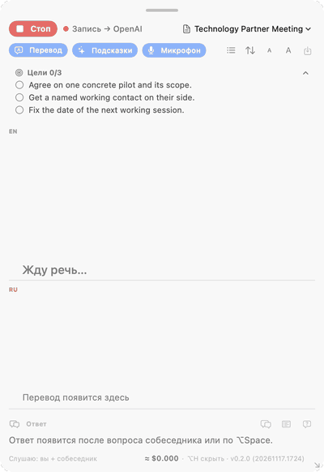
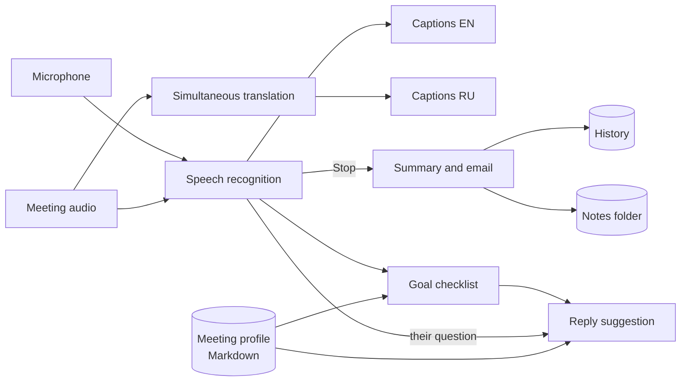

# Stealth — AI Meeting Copilot for macOS

[English](README.md) · [Русский](README.ru.md)

A native window that floats over Teams, Zoom or Google Meet during meetings held in English. It shows live captions of what the other side says with a Russian translation, suggests a short English reply based on the meeting context, steers the conversation toward your goals, and writes a summary after the call.

Based on [vortechron/stealth](https://github.com/vortechron/stealth) (MIT).

A scripted demo — no real meeting data.

## How it works

Audio is sent to OpenAI only while recording; the text of the conversation stays on your Mac.

## Typical uses

**Negotiating with a foreign vendor.** Before the meeting you fill in a profile: who they are, what you want to achieve, what you must not promise. During the call you read the translation, and when they ask "What is your timeline?" you get a ready phrase and see which goal it moves forward.

**A technical session with unfamiliar terminology.** The profile holds an "EN — RU" glossary and the key facts about your project. The translation keeps terms in the original, and the suggestions use the right words.

**A meeting with several goals.** Goals from the profile become a checklist. As the conversation goes on you see what has been covered and what is still not agreed; suggestions bring the talk back to the open items.

**A quick answer when you missed or did not understand something.** `⌥R` gives a short recap of the last minutes in Russian, `⌥Space` tells you what to say right now, `⌥F` offers a fitting question to ask back.

**Minutes without manual work.** After "Stop" a note appears in your knowledge base: outcomes, agreements, action items, open questions, a draft follow-up email in English, and the full transcript with translation.

**Preparing for an important call.** Run the app on a recording of a similar meeting or a video on the topic, and check how the profile and goals behave before the real conversation.
