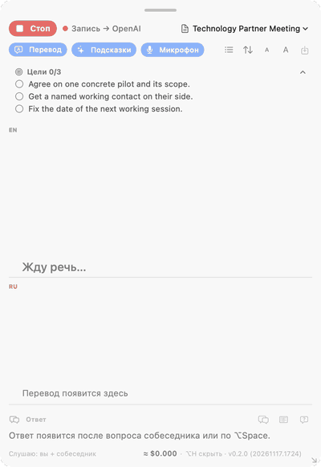
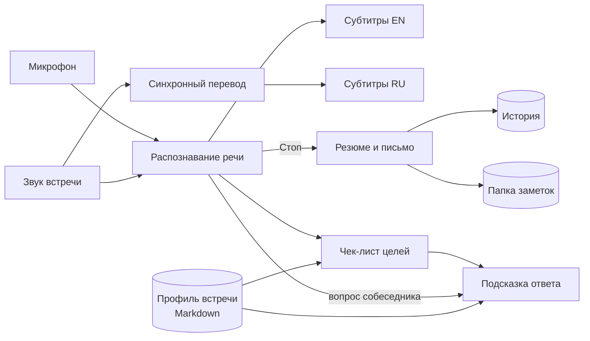

# Stealth — AI Meeting Copilot для macOS

[English](README.md) · [Русский](README.ru.md)

Нативное окно поверх Teams, Zoom или Google Meet для встреч на английском. Показывает субтитры речи собеседника и русский перевод, подсказывает короткий ответ на английском с учётом контекста встречи, ведёт разговор к заданным целям и после звонка пишет резюме.

Основано на [vortechron/stealth](https://github.com/vortechron/stealth) (MIT).

Сценарий демо-режима — данные не настоящие.

## Схема

Звук идёт в OpenAI только во время записи; текст разговора хранится на Mac.

## Примеры применения

**Переговоры с зарубежным вендором.** Перед встречей заполняете профиль: кто собеседник, чего хотите добиться, что нельзя обещать. Во время звонка читаете перевод, а на вопрос «What is your timeline?» получаете готовую фразу и видите, к какой цели она ведёт.

**Техническая сессия с незнакомой терминологией.** В профиле — глоссарий «EN — RU» и ключевые факты о проекте. Перевод держит термины в оригинале, подсказки используют правильные слова.

**Встреча с несколькими целями.** Цели из профиля превращаются в чек-лист. По ходу разговора видно, что уже обсудили и о чём ещё не договорились; подсказки возвращают разговор к открытым пунктам.

**Быстрый ответ, когда не расслышал или не понял.** `⌥R` — краткое резюме последних минут по-русски, `⌥Space` — что ответить прямо сейчас, `⌥F` — уместный встречный вопрос.

**Протокол без ручной работы.** После «Стоп» в базе знаний появляется заметка: итоги, договорённости, задачи, открытые вопросы, черновик письма на английском и полная расшифровка с переводом.

**Подготовка к важному звонку.** Включаете приложение на записи похожей встречи или на видео по теме и проверяете, как профиль и цели работают, до настоящего разговора.
